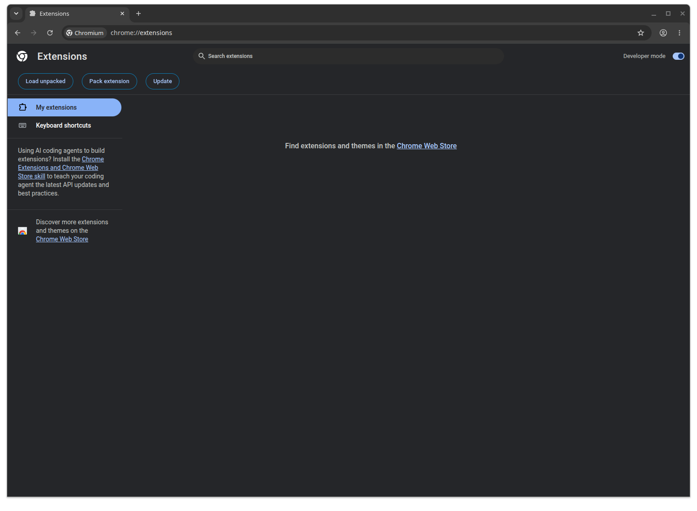
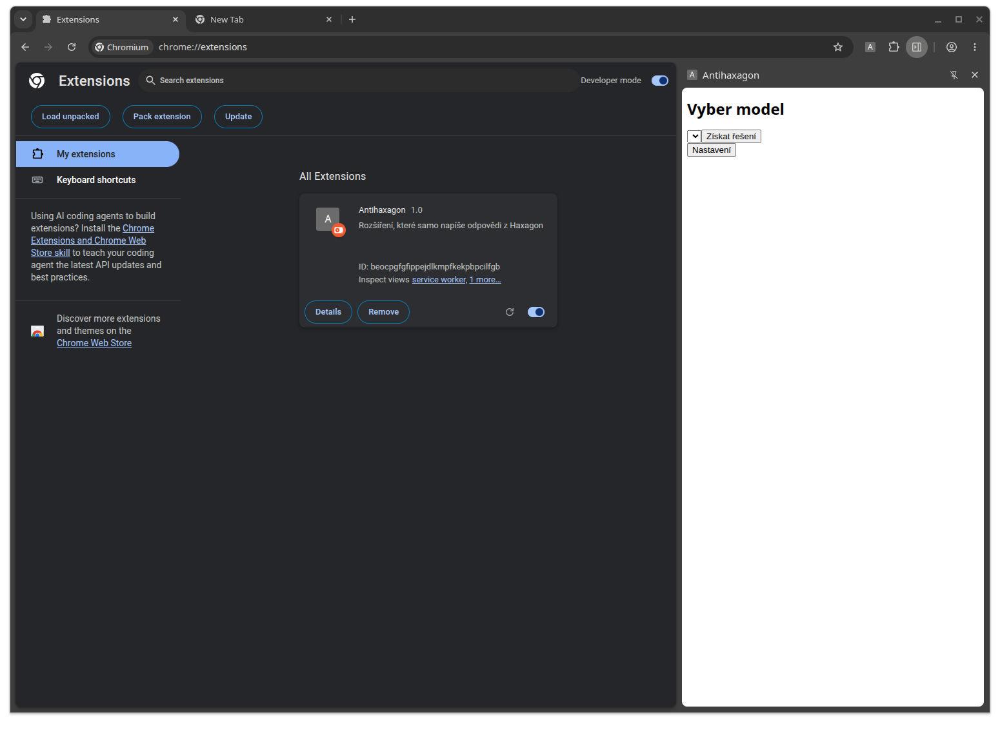
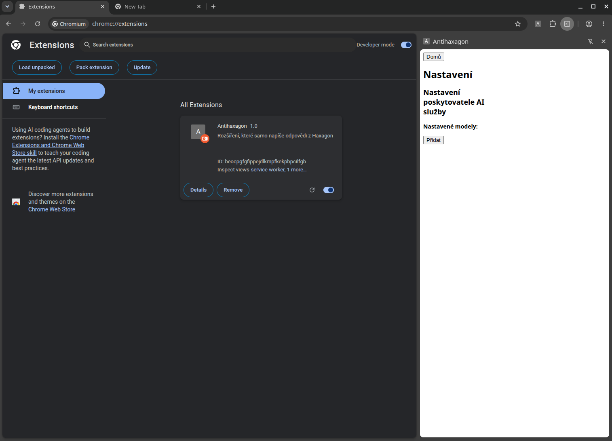
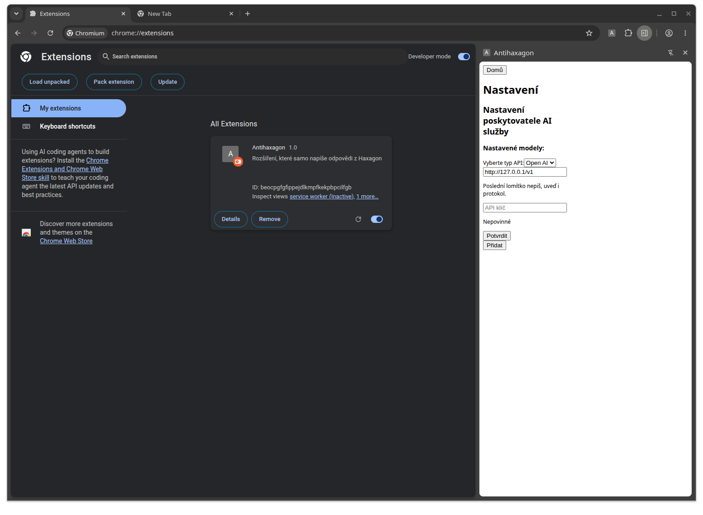

# AntiHaxagon

Projekt AntiHaxagon je určen na řešení vybíracích úkolů na vzdělávací platformě Haxagon. Úkoly se řeší za pomoci externě napojené AI, tedy si každý uživatel musí obsarat nějakého zprostředkovatele připojení (jako je například Ollama, LM Studio - doporučeno, či externě Open AI).

## Zprovoznění v prohlížeči

### 1. Zapnuté vývojářského režimu

Pro zprovoznění v prohlížeči je nutné si stáhnout rozšíření určené pro prohlížeče založené na jádru Chromium (tedy např. Google Chrome, Microsoft Edge, Brave). Zatím rozšíření není v seznamu oficiálních rozšířeních. Pro jeho spuštění je nutmé mít zapnutý `Developer mode`. Zapnuté provedete v pravém horní okraji stránky `chrome://extensions`

### 2. Stažení

Stáhněte si `.zip` soubor s aktuální verzí AntiHaxagonu.  
[Stáhnout AntiHaxagon v1.0.0](https://github.com/JanZetek/antihaxagon/releases/download/v0.0.1/Antihaxagon.v0.0.1.zip)

### 3. Nahrání do prohlížeče

V prohlížeči nahrajete rozšíření jako zabalené.

### 4. Připojení AI

1. Otevřete rozšíření
    
1. Klikněte na tlačítko `Nastavení`
    
1. Vyplntě nastavení
    
